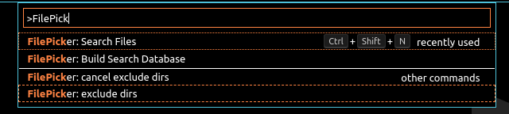
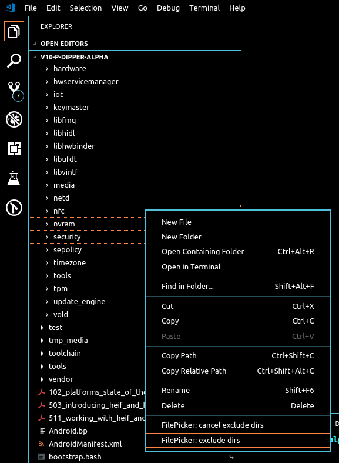

# Fast File Picker

## Features
- support search file using relavtive path like './src/hello.h'
- support search file using absolute path like '/(project_root_path)/src/hello.h'
- support pick from recently opened files
- support multiple workspace folders

## How to use
Hit `Ctrl + Shirft + P` and input 'FilePicker', you'll see:
```
> FilePicker: Search Files
> FilePicker: Build Search Database
```

## Steps:
- Exclude certain directories that you don't want them to be scanned in the follow up step (optional)
- Built the search database (mandatory, one time)    
   note:  
   1. you have to manually execute this command, because this would take a few seconds for a large project, like the [AOSP](https://source.android.com/) project;
   2. when files changed a lot in the workspace, files deleted/renamed/added, you might want to re-execute this command again, because the feature of watching files changes and re-indexing them aren't implemented yet, 0_0||.
- Search for files
That's it!

    


## Screenshot
    




## Bugs
Visit https://github.com/wwm0609/quickfilepicker/ and file an issue

----------------------------------------------------------------------------

## TODO
- test on Windows

## How To Run Locally
Clone this project into your local disk and open it in vscode, press F5, there you go!

## Search semantics
- `name` — matches file names (substring) and CamelCase acronyms, e.g. `ams` finds `ActivityManagerService.java`
- `foo bar` — multiple terms are ANDed, every term must match
- `src/foo` or `foo/` — any term containing `/` matches the full path
- plain terms also match directory names, e.g. `framework` finds files under a `frameworks/` directory
- `!term` excludes files matching the term, `!.ext` excludes by extension
- `.ext` (when other terms are present) filters by extension, e.g. `ams .java`
- when few or no strict matches are found, terms fall back to fuzzy
  subsequence matching with scoring, e.g. `actmgr` finds `ActivityManagerService.java`
- results are ranked: exact name > name prefix > acronym > name substring > path
  > fuzzy; recently opened files win ties
- backed by a trigram index that is persisted across sessions, so searches stay
  fast on projects with hundreds of thousands of files

## Code structure
```
src/
  extension.ts        activation and command wiring
  quickOpen.ts        QuickPick UI only
  search.ts           pattern compilation, matching and ranked search (pure logic)
  trigramIndex.ts     trigram + shortName inverted index (pure logic)
  indexedFile.ts      index entry type and name/acronym helpers (pure logic)
  fileIndexing.ts     build / load / persist the per-workspace file database
  settings.ts         excludeDirs / excludeFileTypes settings handling
  paths.ts            workspace helpers and database file locations
  recentFileHistory.ts  LRU of recently opened files
  logger.ts           leveled logging
  test/selftest.ts    unit tests for the pure modules (npm test)
```
