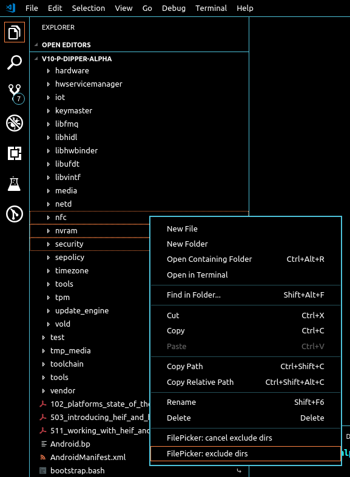

# Fast File Picker

[English](README.md) | **简体中文**

一个为 VS Code 打造的高速文件选择器，专为 **超大型代码库**（例如
[AOSP](https://source.android.com/)）设计——在这类项目中，VS Code 自带的
Quick Open 往往会明显变慢。

插件会先对工作区中的所有文件建立一次索引，之后直接在内存中的 trigram
索引上检索，因此即使有数十万个文件，输入时也能即时返回结果。

## 功能特性

- **索引化搜索** —— 每个工作区都有持久化的文件索引，以及 trigram / 缩写 /
  目录段索引；每次按键都不需要重新遍历目录。
- **智能查询语法** —— 支持文件名、路径、CamelCase 缩写、扩展名过滤、排除项
  和模糊匹配（见[查询语法](#查询语法)）。
- **结果排序** —— 按“完整文件名 > 前缀 > CamelCase 缩写 > 文件名子串 > 路径 >
  模糊匹配”排序；同一等级内最近打开过的文件优先。
- **最近打开的文件** —— 输入框为空时显示。
- **多根工作区** —— 会搜索多根工作区中的每一个根目录。
- **快捷排除** —— 在资源管理器中右键文件夹即可排除，并立即重新索引。
- **支持 `compile_commands.json`** —— C/C++ 编译数据库会作为额外的文件路径
  来源。

## 快速开始

1. 安装插件。
2. 执行一次 **FilePicker: Build Search Database** 命令
   （`Ctrl+Shift+P` → 输入 `FilePicker`）。
   在大项目上这可能需要几秒钟，通知区域会显示进度。
3. 按下 `Ctrl+P`（macOS 为 `Cmd+P`）开始输入。
   `Enter` 打开文件，`Esc` 关闭选择器。


> 插件会把 `Ctrl+P` / `Cmd+P` 绑定到自己的选择器。如果想保留 VS Code 原生的
> Quick Open，可以在 *键盘快捷方式*（`Ctrl+K Ctrl+S`）中重新绑定
> **FilePicker: Search Files**。

## 命令

| 命令 | 说明 |
| --- | --- |
| **FilePicker: Search Files** | 打开文件选择器（`Ctrl+P` / `Cmd+P`）。 |
| **FilePicker: Build Search Database** | 重新扫描工作区并重建索引。 |
| **FilePicker: exclude dirs** | 排除选中的文件夹；也可在资源管理器右键菜单中执行。 |
| **FilePicker: cancel exclude dirs** | 将之前排除的文件夹重新加入索引。 |

## 查询语法

查询会按空白字符拆分为多个词条。**所有正向词条都必须匹配**（AND 语义）——
`foo bar` 可以找到 `barfoo.c` 和 `foo/bar.c`，但找不到 `foo.c`。

| 查询 | 含义 |
| --- | --- |
| `name` | 按文件名子串匹配，或按 CamelCase 缩写前缀匹配：`ams` → `ActivityManagerService.java`。同时也会匹配目录段前缀：`framework` → `frameworks/` 下的文件。 |
| `src/foo` | 含 `/` 的词条会匹配完整路径，开头的 `./` 会被忽略。 |
| `foo bar` | AND：每个词条都必须匹配。 |
| `.java` | 扩展名过滤（在存在其他词条时生效），例如 `ams .java`。 |
| `!test` | 排除匹配 `test` 的文件。单独的 `!.ext` 用于排除某种扩展名，例如 `!test !.java`。 |
| `actmgr` | 没有严格匹配时，词条会回退为带评分的模糊子序列匹配：`actmgr` → `ActivityManagerService.java`。 |

排序规则为：**完整文件名 > 文件名前缀 > CamelCase 缩写 > 文件名子串 >
路径匹配 > 模糊匹配**，同等级内最近打开的文件优先。

如果输入的是一个真实存在的路径（例如 `src/main.ts`），会直接打开该文件——
适合已经记住完整路径的场景。

## 配置

所有配置项位于 **设置 → 扩展 → FilePicker**。

| 配置项 | 默认值 | 说明 |
| --- | --- | --- |
| `FilePicker.excludeDirs` | `""` | 不参与索引的目录。多个条目用 `:` 分隔，可以写 `"${workspace}/out"`、绝对路径，或裸目录名（如 `out`，匹配任意位置的同名目录）。隐藏目录以及 `.git`、`.repo`、`.vscode` 始终会被跳过。 |
| `FilePicker.excludeFileTypes` | `""` | 不参与索引的文件类型，用 `:` 分隔，例如 `.png:.jpg:.mp4`。隐藏文件始终会被跳过。 |
| `FilePicker.showDebugLog` | `"None"` | 日志等级：`None`、`Verbose`、`Debug`、`Info`、`Warning`、`Error`。 |

示例：

```json
{
  "FilePicker.excludeDirs": "${workspace}/out:${workspace}/build:/mnt/shared/generated",
  "FilePicker.excludeFileTypes": ".png:.jpg:.mp4"
}
```

> **修改任一排除配置后都需要重建数据库**——这两个配置只在建立索引时生效。

也可以不编辑配置直接排除文件夹：在资源管理器中右键该文件夹，选择
**FilePicker: exclude dirs**。它会立即从索引中移除；执行
**FilePicker: cancel exclude dirs** 可重新加入。



## 工作原理

```
Ctrl+P ──► 查询解析 ──► trigram 候选集 ──► 排序结果 ──► Quick Pick
                          (索引)          (search.ts)
```

- **数据库** —— 每个工作区一个纯文本文件，每行一个路径，位于
  `~/.q_file_picker/<编码后的工作区路径>/file_index.db`。写入是原子操作，且
  永远不会放进你的仓库。
- **索引** —— 文件名上的 trigram 倒排索引、用于 CamelCase 文件名的缩写桶索引，
  以及用于路径词条的目录段索引。底层使用 `Uint32Array`，在 31 万个文件时内存
  占用约为 15–20 MB。
- **持久化缓存** —— 索引会序列化到 `trigram_index.cache`，并以路径列表的哈希
  作为有效性校验，因此扩展宿主重启后无需重建。
- **响应迅速** —— 输入有 80 ms 防抖；输入一旦变化，正在进行的搜索会立即取消；
  首批匹配结果会先展示，其余结果继续在后台计算。

## 已知限制

- **索引不会监听文件变化。** 大量文件新增、重命名或删除后，请再次执行
  **FilePicker: Build Search Database**。
- 隐藏文件和隐藏目录永远不会被索引。
- 范围过宽的查询只会返回排序最靠前的 300 条结果，请缩小查询范围以查看更多。

## 开发

环境要求：Node.js 18+、VS Code 1.75+。

```bash
npm install
npm run compile    # 或：npm run watch
npm test           # 编译并运行纯逻辑模块的单元测试
npm run package    # 使用 vsce 打包 .vsix
```

在 VS Code 中按 `F5` 可启动扩展开发宿主进行调试。

### 代码结构

代码按职责分层，搜索逻辑不依赖 VS Code，可以直接测试：

```
src/
  extension.ts          插件激活与命令注册
  quickOpen.ts          仅负责 Quick Pick UI
  search.ts             查询解析、匹配与排序搜索（纯逻辑）
  trigramIndex.ts       trigram + 缩写 + 目录索引（纯逻辑）
  indexedFile.ts        索引条目类型与文件名/缩写辅助函数（纯逻辑）
  fileIndexing.ts       构建 / 加载 / 持久化每个工作区的数据库
  settings.ts           excludeDirs / excludeFileTypes 配置处理
  paths.ts              工作区辅助函数与数据库文件位置
  recentFileHistory.ts  最近打开文件的 LRU
  logger.ts             分级日志
  test/selftest.ts      纯逻辑模块的单元测试（npm test）
```

## 反馈

发现 bug 或有建议？欢迎在
[github.com/wwm0609/quickfilepicker](https://github.com/wwm0609/quickfilepicker/issues)
提交 issue。
